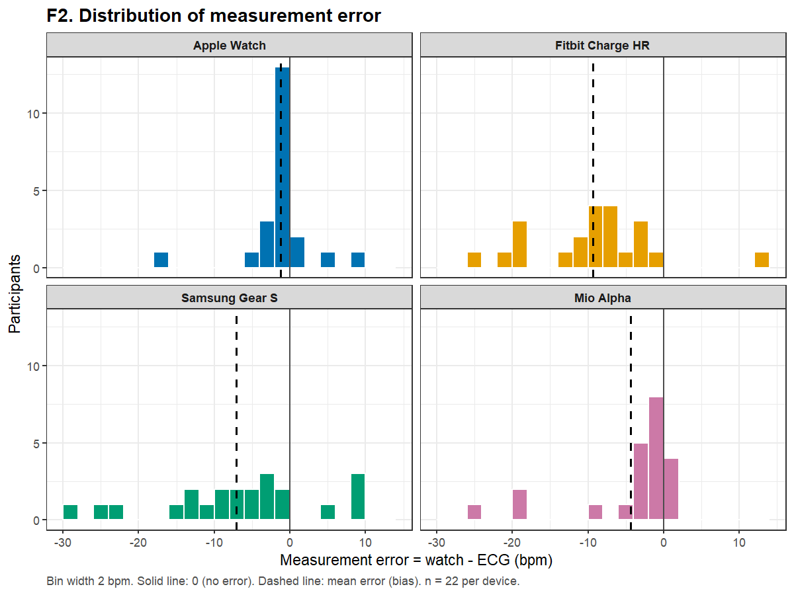
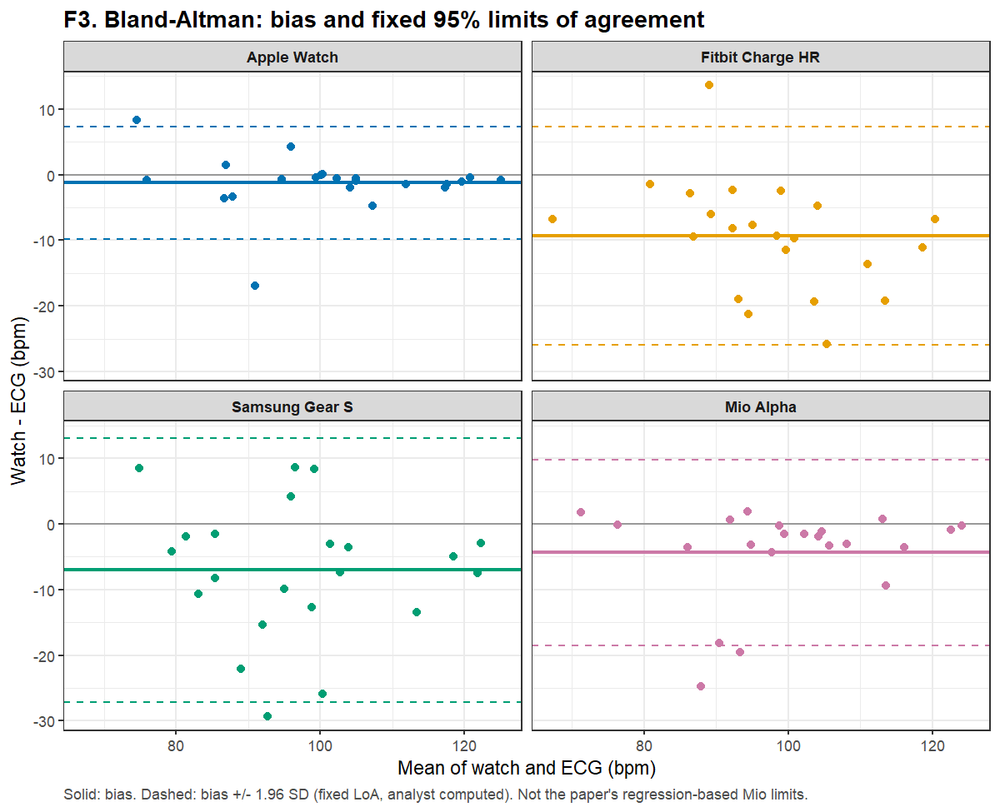
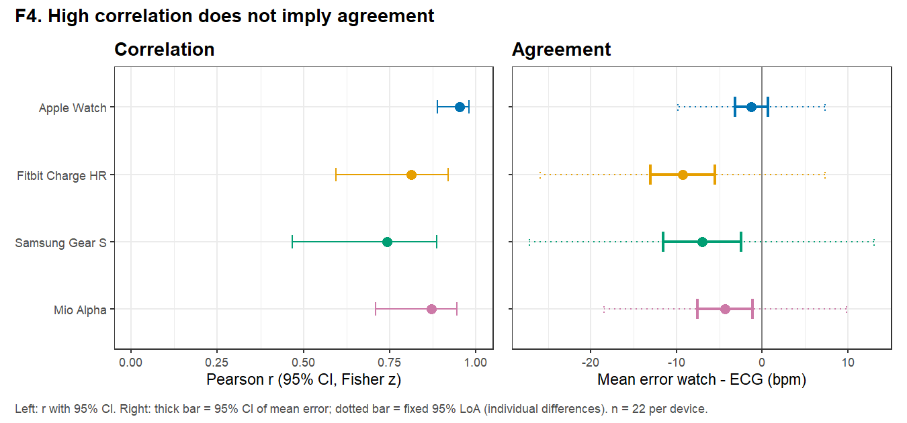

<!-- 자동 생성: analysis/templates/HR04-paper.md 에서 run R1-20261025 / R2-20261025 표로 채움. 직접 고치지 말고 템플릿을 고칠 것. -->
# HR04 · PAPER — 측정오차(시계 − ECG)의 평균과 분포, Bland–Altman

> 논문·실제 데이터 적용 페이지. 수치는 run `R1-20261025` `hr04_error.csv`에서 채웠다. 일반 개념은 [HR04-concept](HR04-concept.md).

## 입력
기기별 22개 오차 e = 시계 − ECG (bpm). 음수 = 시계가 낮게 잼.

## 이번 질문
시계는 ECG와 평균적으로 얼마나 다른가(bias)? 사람마다 얼마나 흩어지는가(SD, LoA)? **상관이 높은 기기도 값이 어긋날 수 있는가?** (6주차 검증 과제)

## 방법과 이유
- [과제] 오차 = 시계 − 기준. [원문]도 같은 방향이다(Table 1 "Mean difference"가 음수이고 "underestimated"로 서술).
- bias 95% CI = t 분포 (자유도 21). 고정 95% LoA = bias ± 1.96 × SD (SD는 n − 1). 둘은 다른 질문에 답한다: CI는 **평균 오차**의 불확실성, LoA는 **한 사람의 오차**가 놓일 범위다.
- `bias/ECG 평균 (%)`는 **부호가 있는** 백분율이다(음수 = 과소측정). 계획서는 |bias|라고 적었으나 코드는 부호를 유지했다. 크기는 같다 (ISS-20).
- [원문] Mio HR은 "systematically biased"로 판단해 LoA를 평균값의 함수(Upper = −0.44·avg + 52.69, Lower = 0.4·avg − 61.2)로 보고했다. 이 **가변 LoA**는 이 페이지의 **고정 LoA와 추정 대상이 다르므로 같은 결과로 비교하지 않는다** (HR06, ISS-10).

## 출력

| 기기 | n | 시계 평균 ± SD | ECG 평균 ± SD | 평균오차(bias) | bias 95% CI (t) | 오차 SD | MAE | RMSE | bias/ECG 평균 (%) | 고정 95% LoA | 음수 오차 수 |
|---|---|---|---|---|---|---|---|---|---|---|---|
| Apple Watch | 22 | 100.7 ± 14.0 | 102.0 ± 14.4 | -1.26 | [-3.20, 0.68] | 4.38 | 2.53 | 4.46 | -1.2 | [-9.84, 7.32] | 18/22 |
| Fitbit Charge HR | 22 | 92.7 ± 11.5 | 102.0 ± 14.5 | -9.32 | [-13.08, -5.56] | 8.48 | 10.55 | 12.47 | -9.1 | [-25.94, 7.30] | 21/22 |
| Samsung Gear S | 22 | 93.4 ± 13.9 | 100.5 ± 14.6 | -7.05 | [-11.60, -2.50] | 10.26 | 9.74 | 12.25 | -7.0 | [-27.15, 13.06] | 18/22 |
| Mio Alpha | 22 | 97.7 ± 14.6 | 102.0 ± 13.4 | -4.34 | [-7.54, -1.14] | 7.22 | 4.81 | 8.28 | -4.3 | [-18.49, 9.80] | 18/22 |

### 상관이 높아도 일치하지 않는다 (검증 과제)
- **Fitbit Charge HR**: r = 0.81로 '강한' 상관(원문 기준 r ≥ 0.7)이지만, 평균오차 -9.3 bpm (95% CI -13.1 ~ -5.6)이다. 22명 중 21명에서 시계가 낮게 읽었다.
- **Mio Alpha**는 r = 0.87로 Fitbit보다 상관이 높지만 bias -4.3 bpm으로 0과 구별되고, LoA 하한이 -18.5 bpm이다. F2에서 대부분은 0 근처에 몰려 있지만 몇 사람이 −15 ~ −25 bpm으로 크게 낮다. 평균과 LoA는 이 소수의 꼬리에 끌린다(중앙값 -1.7).
- **Apple Watch**만 bias -1.3 bpm의 95% CI(-3.2 ~ 0.7)가 0을 포함한다. 그래도 개인 오차는 LoA -9.8 ~ 7.3 bpm 범위다.
- **Samsung Gear S**는 LoA 폭이 가장 넓다(-27.2 ~ 13.1). 원문도 Samsung을 HR 변동이 가장 큰 기기로 보고했다.
- 네 기기 모두 평균 오차가 음수다. 원문의 "All devices underestimated" 및 "1–9%"와 같은 방향·크기다(bias/ECG 평균 = Apple -1.2% ~ Fitbit -9.1%, 음수 = 과소측정).

F4가 이 대비를 한눈에 보여 준다. 왼쪽 상관 순서와 오른쪽 오차 크기의 순서가 같지 않다.

## 남은 질문
- 몇 bpm까지 허용할지는 사용 목적(운동 강도 처방, 에너지 소비 추정)이 정해야 하며, 이 분석은 허용 기준을 정하지 않았다. 따라서 "임상적으로 교환 가능하다/불가능하다"는 판정을 내리지 않는다.
- 이 오차는 **약 58분 평균 HR**의 오차다. 순간 HR이나 활동별 오차는 더 클 수 있으나 공개 자료로는 볼 수 없다 (ISS-03).
- 오차 분포가 꼬리를 가지면(Mio, Apple) ±1.96 SD의 '95%' 해석은 근사다. LoA의 CI는 계산하지 않았다.
