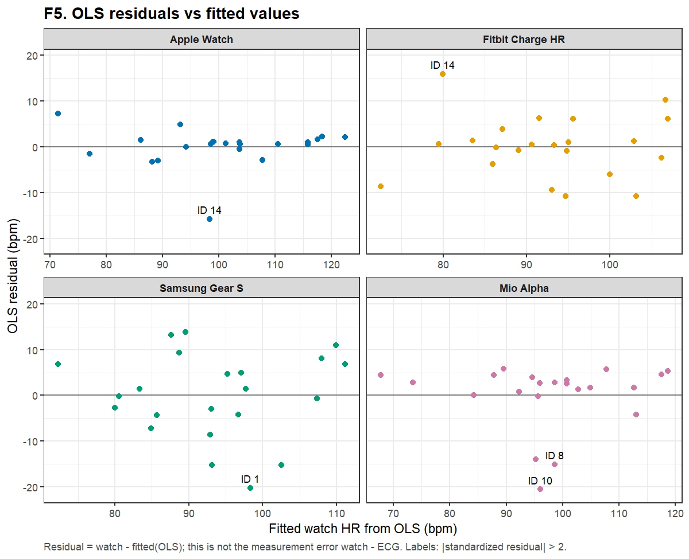
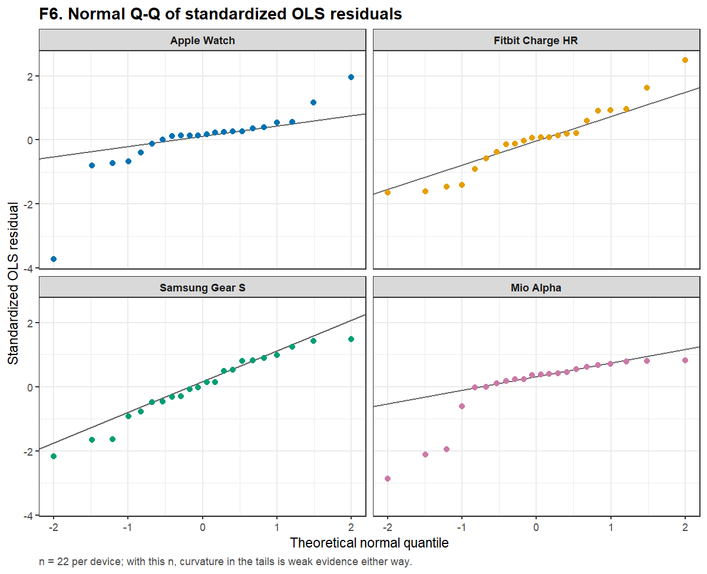
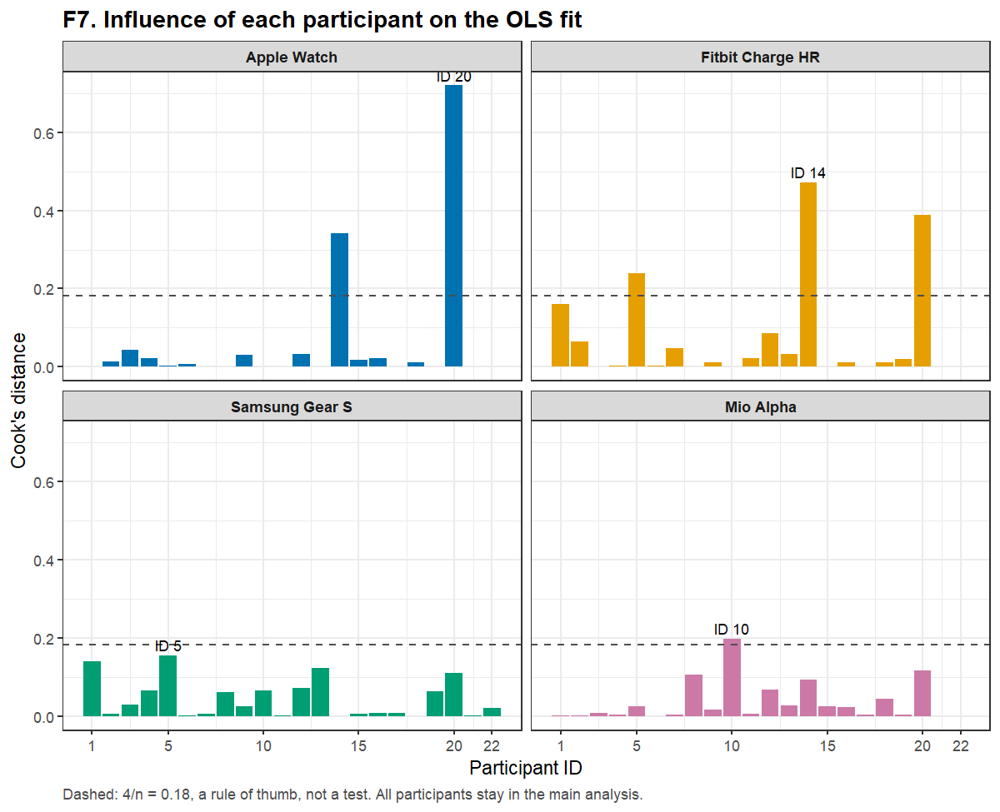

<!-- 자동 생성: analysis/templates/HR05-paper.md 에서 run R1-20261025 / R2-20261025 표로 채움. 직접 고치지 말고 템플릿을 고칠 것. -->
# HR05 · PAPER — 잔차 진단, 영향점, 한 명씩 제외 민감도

> 논문·실제 데이터 적용 페이지. 수치는 run `R1-20261025` `hr05_*.csv`에서 채웠다. 일반 개념은 [HR05-concept](HR05-concept.md).

## 입력
HR03의 기기별 OLS 모형 4개, HR04의 오차.

## 이번 질문
기기별 OLS가 가정을 크게 어기는가? 특정 한 사람이 r·기울기·bias·LoA를 좌우하는가?

## 방법과 이유
- [원문] 잔차 진단이나 영향점 분석을 보고하지 않았다. 이 단계는 **과제의 보조 진단**이며 원문 재현이 아니다.
- 잔차 대 적합값, 표준화 잔차 Q–Q, Cook's distance (참조선 4/n = 0.18은 경험칙).
- 한 명씩 제외: 기기마다 22번, 매번 1명을 빼고 21명으로 다시 계산. **주 분석(22명 전원)은 그대로 두고** 별도 시나리오로만 보인다. 이 범위는 CI가 아니고, 새 사람에 대한 예측을 재는 교차검증도 아니다.

## 출력

Cook's D > 4/n 또는 |표준화 잔차| > 2인 경우:

| 기기 | ID | 시계 HR | ECG HR | 측정오차 | OLS 잔차 | 표준화 잔차 | 레버리지 | Cook's D |
|---|---|---|---|---|---|---|---|---|
| Apple Watch | 20 | 78.67 | 70.36 | 8.31 | 7.22 | 1.95 | 0.275 | 0.720 |
| Apple Watch | 14 | 82.57 | 99.46 | -16.89 | -15.82 | -3.73 | 0.047 | 0.342 |
| Fitbit Charge HR | 14 | 95.86 | 82.27 | 13.59 | 15.89 | 2.48 | 0.133 | 0.472 |
| Fitbit Charge HR | 20 | 63.88 | 70.65 | -6.77 | -8.61 | -1.46 | 0.267 | 0.389 |
| Fitbit Charge HR |  5 | 117.01 | 123.78 | -6.77 | 10.31 | 1.63 | 0.153 | 0.239 |
| Samsung Gear S |  1 | 78.07 | 107.37 | -29.30 | -20.25 | -2.18 | 0.056 | 0.141 |
| Mio Alpha | 10 | 75.49 | 100.29 | -24.80 | -20.55 | -2.86 | 0.046 | 0.198 |
| Mio Alpha |  8 | 83.49 | 103.02 | -19.53 | -15.13 | -2.11 | 0.046 | 0.106 |

한 명씩 제외한 결과의 범위:

| 기기 | 지표 | 전체 22명 | 한 명씩 제외한 21명 결과의 범위 | 가장 크게 바꾼 제외 ID |
|---|---|---|---|---|
| Apple Watch | Pearson r | 0.953 | 0.944 ~ 0.985 | 14 |
| Apple Watch | 기울기 | 0.926 | 0.911 ~ 0.998 | 20 |
| Apple Watch | bias | -1.26 | -1.72 ~ -0.52 | 14 |
| Apple Watch | LoA 하한 | -9.84 | -10.09 ~ -5.81 | 14 |
| Apple Watch | LoA 상한 | 7.32 | 4.78 ~ 7.58 | 14 |
| Fitbit Charge HR | Pearson r | 0.812 | 0.747 ~ 0.874 | 20 |
| Fitbit Charge HR | 기울기 | 0.644 | 0.561 ~ 0.725 | 20 |
| Fitbit Charge HR | bias | -9.32 | -10.41 ~ -8.53 | 14 |
| Fitbit Charge HR | LoA 하한 | -25.94 | -26.44 ~ -23.86 |  1 |
| Fitbit Charge HR | LoA 상한 | 7.30 | 3.17 ~ 7.81 | 14 |
| Samsung Gear S | Pearson r | 0.743 | 0.697 ~ 0.797 |  1 |
| Samsung Gear S | 기울기 | 0.709 | 0.641 ~ 0.770 |  5 |
| Samsung Gear S | bias | -7.05 | -7.79 ~ -5.99 |  1 |
| Samsung Gear S | LoA 하한 | -27.15 | -27.76 ~ -24.01 |  1 |
| Samsung Gear S | LoA 상한 | 13.06 | 11.57 ~ 13.67 | 10 |
| Mio Alpha | Pearson r | 0.870 | 0.848 ~ 0.915 | 10 |
| Mio Alpha | 기울기 | 0.946 | 0.908 ~ 1.000 | 20 |
| Mio Alpha | bias | -4.34 | -4.64 ~ -3.37 | 10 |
| Mio Alpha | LoA 하한 | -18.49 | -18.92 ~ -14.58 | 10 |
| Mio Alpha | LoA 상한 | 9.80 | 7.85 ~ 10.22 | 10 |

### 읽는 법
- **Apple Watch ID 20**은 ECG가 가장 낮은 사람(레버리지 큼)이라 Cook's D가 가장 크다. 빼면 기울기가 0.926에서 0.998까지 움직인다. **Apple ID 14**는 오차가 큰 사람(시계 82.57 vs ECG 99.46)으로, 빼면 LoA 하한이 -9.8에서 -5.8로 좁아진다. 그래도 Apple의 r은 어떤 한 명을 빼도 0.944 이상이다.
- **Fitbit ID 14**는 시계가 ECG보다 **높게** 읽은 드문 사람이다. 빼면 LoA 상한이 7.3에서 3.2로 줄어든다. 그래도 Fitbit bias는 -10.4 ~ -8.5 범위에 머문다.
- **Mio ID 10**(시계 75.49 vs ECG 100.29)이 Mio의 큰 음의 꼬리를 대표한다. 빼면 LoA 하한이 -18.5에서 -14.6로 바뀐다.
- Q–Q(F6)에서 Apple·Mio의 아래쪽 꼬리가 직선에서 벗어난다. n = 22에서는 결정적 근거가 아니지만, HR04의 LoA를 '정확히 95%'로 읽지 말아야 할 이유다.
- **결론**: 어떤 한 명을 빼도 bias의 부호(음수)와 기기들의 대략적인 순서는 바뀌지 않는다. LoA 폭은 한두 사람에 민감하다. 영향이 큰 사람은 시계가 실제로 크게 틀린 사례일 수 있으므로 **주 분석에서 지우지 않았다** (ISS-14).

## 남은 질문
- 왜 이 사람들에서 크게 틀렸는가(움직임, 착용 위치, 피부 유형)는 평균 자료로 알 수 없다. 원문은 피부 유형 하위집단 상관을 보고했지만 범위 밖이다.
- 등분산 가정은 F5에서 크게 어긋나 보이지 않지만 검정하지 않았다.
